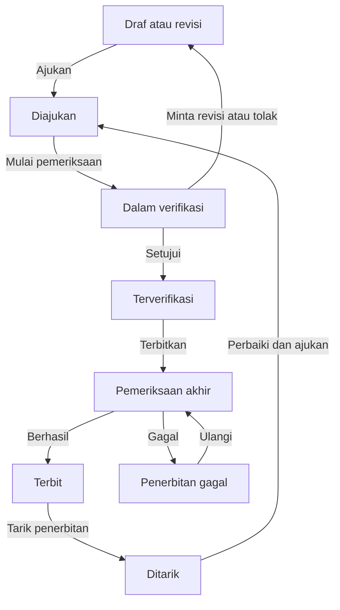
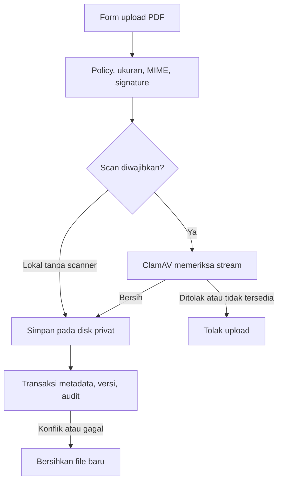

# Alur aplikasi

## 1. Dua area aplikasi

Area publik menyediakan beranda, pencarian, profil dosen/penulis, dan detail karya. Karya baru tidak langsung tampil: hanya karya berstatus terbit, memiliki `public_visibility=public`, dan tidak diarsipkan yang dapat ditemukan publik.

Area ruang kerja membutuhkan login dan akun aktif. Dalam konfigurasi production, email juga harus diverifikasi. Dashboard dan daftar karya mengikuti hak pengguna; kontributor tidak mendapatkan daftar seluruh draf institusi. Pengelolaan akun membutuhkan konfirmasi password yang masih berlaku.

## 2. Akun dan identitas penulis

`users` adalah akun login; `penulis` adalah identitas akademik. Keduanya tidak otomatis sama. Admin menghubungkan profil penulis setelah memeriksa identitas. Satu penulis hanya dapat terhubung ke satu akun, dan satu akun hanya memiliki satu profil penulis.

Registrasi mandiri hanya menghasilkan peran mahasiswa. Pada production registrasi dimatikan secara default; institusi dapat mengaktifkannya melalui `REGISTRATION_ENABLED`. Akun baru menerima verifikasi melalui queue. Admin pertama dibuat dengan `repository:create-admin`; tidak ada password production bawaan. Jangan menggunakan seeder demo untuk membuka layanan publik.

Saat login berhasil, session ID diganti, versi keamanan akun dicatat, dan waktu login/aktivitas disimpan. Session aktif tetap mempunyai batas idle 30 menit dan usia 8 jam. Remember me bersifat opsional, maksimal 14 hari: saat cookie session hilang, cookie recall yang masih sah dapat membentuk sesi baru; recall tidak melewati konfirmasi password untuk tindakan sensitif. Perubahan password, email, peran, atau status aktif mencabut sesi lama pada permintaan berikutnya. Logout membatalkan session dan mengganti token CSRF.

## 3. Hak akses

| Aktivitas | Admin | Operator | Verifier | Dosen / mahasiswa / eksternal |
| --- | --- | --- | --- | --- |
| Master data | Ya | Ya | Tidak | Tidak |
| Pengguna dan peran | Ya, konfirmasi password | Tidak | Tidak | Tidak |
| Membuat karya | Ya | Ya | Tidak | Ya |
| Membaca karya internal | Semua | Semua | Semua publikasi | Karya buatan sendiri atau terkait sebagai penulis |
| Mengedit | Karya pada status yang dapat diedit | Sama | Tidak | Pembuat; untuk publikasi juga penulis korespondensi/peneliti utama terkait akun |
| Verifikasi publikasi | Ya; karya sendiri wajib alasan dan audit | Tidak | Ya, jika bukan pembuat/penulis | Tidak |
| Menerbitkan / menarik penerbitan | Ya | Ya | Tidak | Tidak |
| Mengarsipkan | Jika dapat mengedit | Jika dapat mengedit | Tidak | Jika dapat mengedit |
| Memulihkan arsip | Ya | Ya | Tidak | Tidak |

Nama role saja tidak cukup untuk izin. `WorkPolicy` juga memeriksa status, kepemilikan, keaktifan akun, dan benturan kepentingan saat verifikasi. Penulis biasa pada buku/HKI boleh membaca karya terkait, tetapi bukan otomatis boleh mengeditnya.

## 4. Membuat karya

1. Pilih Jurnal, Buku, atau Kekayaan Intelektual → Tambah.
2. **Data karya:** isi judul, tahun, akses metadata, dan susun penulis/pencipta. Pilih rekomendasi atau ketik nama baru. Mahasiswa dapat mengisi NIM; dosen baru wajib NIDN 10 digit. Fakultas/prodi dapat diisi jika diketahui, termasuk nama baru; afiliasi yang belum diketahui dibiarkan kosong.
3. **Identitas terbitan:** isi jurnal/prosiding atau penerbit dari rekomendasi maupun nama baru, DOI, ISBN/ISSN, tanggal, dan SINTA/Scopus jika tersedia. Metadata tambahan dan prodi disembunyikan dalam bagian opsional yang dapat dibuka.
4. **File pendukung:** pilih jenis file dan akses setiap PDF. Nama jenis seperti Cover ditampilkan di atas file. Maksimal 5 file per penyimpanan, total 20 MB. Boleh menyimpan tanpa file dan melengkapinya dari detail.
5. Simpan draf. Metadata, referensi baru, relasi, audit, serta file diproses sebagai satu operasi. Kegagalan menggagalkan perubahan database dan membersihkan file baru yang sudah tersimpan. Pilih ulang file setelah validasi server gagal, karena browser tidak memulihkan file input.
6. Periksa draf lalu ajukan verifikasi dari halaman detail. Alur status dan penerbitan tetap seperti sebelumnya.

Judul, minimal satu penulis aktif, dan visibility wajib pada penyimpanan. Tahun wajib ketika karya diajukan/disetujui/diterbitkan. DOI dinormalisasi dan unik per artikel. ISBN buku unik; ISBN prosiding boleh dipakai beberapa artikel dalam terbitan yang sama. Identitas ISBN/ISSN diperiksa formatnya, belum merupakan pemeriksaan checksum atau validasi penerbit eksternal.

Penulis baru tidak membuat akun login. Nama dan NIDN yang cocok menggunakan dosen yang sama; konflik NIDN dengan nama lain ditolak. Untuk mahasiswa/eksternal, identitas dan nama membantu pencocokan; tanpa identitas, pencocokan dibatasi pada input kontributor yang sama. Nama identik saja tidak membuktikan orang yang sama. Master yang sudah ada tidak ditimpa otomatis. Referensi baru merupakan data yang dimasukkan pengguna dan masih perlu diperiksa pengelola.

### Metadata jurnal dan cara input (1.6)

Menu **Jurnal** tetap memakai route `/admin/karya/publikasi` dan tabel `publikasi` agar URL serta integrasi lama tetap berjalan. `jurnal` adalah katalog referensi nama jurnal; `publikasi` menyimpan artikel/karya individual.

| Informasi | Penyimpanan | Pilihan |
| --- | --- | --- |
| Jenis karya | `publication_type` | Artikel jurnal, prosiding, karya ilmiah lainnya |
| Identitas jurnal dari referensi | `jurnal_id` | Katalog jurnal yang sudah tersedia |
| Identitas jurnal manual | Input `journal_name_manual`, disimpan menjadi `jurnal_id` | Rekomendasi baru dibuat/dipakai ulang dalam transaksi; nilai manual lama tetap terbaca sampai diedit |
| Cara mengisi indeks | `indexing_mode` | `reference` atau `manual` |
| SINTA | `sinta_rank` | 1–6 atau belum dicatat |
| Scopus | `scopus_indexed`, `scopus_quartile` | Terindeks; Q1–Q4 boleh belum diketahui |
| Bukti peringkat | `indexing_year`, `indexing_source` | Tahun dan tautan sumber HTTP/HTTPS |

Pilihan nama jurnal dan pilihan cara mengisi indeks independen. Pada mode referensi, tambahkan pengindeks SINTA dan tingkat S1–S6, atau Scopus dan Q1–Q4. Pasangan peringkat yang tidak sesuai ditolak server. Pada mode manual, isi peringkat langsung; menonaktifkan Scopus mengosongkan kuartil. Beralih ke mode manual mengganti relasi pengindeks pada **karya itu saja**. Master referensi bersama tetap utuh. Penulis dapat dipilih dari rekomendasi atau ditambahkan langsung; hubungan akun dan hak kepemilikan tidak berubah otomatis.

Peringkat merupakan data yang dicatat oleh pengelola/penulis, bukan hasil sinkronisasi otomatis atau sertifikasi aplikasi. Perubahan nama referensi tidak otomatis mengubah snapshot peringkat karya yang sudah tersimpan. Koreksi melalui edit karya.

Filter SINTA/Scopus, jenis, tahun, fakultas, prodi, dosen, pengindeks referensi, serta pengurutan dapat digabung. Ruang kerja menambah status dan akses metadata. Prodi/fakultas mengikuti afiliasi dosen pada penulis karya; penulis tanpa relasi dosen tidak akan cocok dengan filter prodi. Pengindeks referensi menyaring pivot, sedangkan filter SINTA/Scopus berlaku untuk input manual maupun referensi. Scope otorisasi dan visibility tetap diterapkan sebelum hasil dikembalikan.

### Upgrade data lama

Migration 1.6 `2026_11_13_022245_add_reference_resolution_keys` menambah unique `entry_key` nullable pada penulis/jurnal/penerbit, membuat afiliasi prodi dosen boleh kosong, serta menambah ISBN/ISSN per artikel. Data lama tidak dihapus atau digabung otomatis. Nama jurnal manual lama baru dibuatkan referensi saat karya disimpan kembali melalui mode manual. `down()` menghapus kolom baru; afiliasi dosen tetap nullable agar dosen tanpa prodi tidak dipaksa memakai nilai palsu. Jangan menjalankan rollback pada data nyata tanpa rencana pemulihan.

Migration `2026_11_10_153540_add_journal_discovery_fields` menambah kolom dan indeks tanpa menghapus karya. Katalog SINTA/Scopus dan S1–S6/Q1–Q4 yang belum ada ditambahkan. Rank lama hanya disalin bila nama/kode eksplisit dikenali; jenis karya lama dibiarkan kosong agar tidak mengarang klasifikasi. Pengelola dapat melengkapinya bertahap lewat edit. Semua status workflow tetap sama.

Lakukan backup sebelum migration. `down()` menghapus kolom baru beserta isinya; jangan memakai rollback sebagai cara menyegarkan UI. Referensi standar yang ditambahkan tidak dihapus saat rollback karena dapat sudah dipakai karya.

## 5. Alur publikasi ilmiah

Admin dapat memilih **Mulai pemeriksaan** lalu **Setujui verifikasi**, **Minta revisi**, atau **Tolak** sesuai status. Jika admin merupakan pembuat/penulis karya, alasan wajib ditulis dan dicatat melalui audit `admin_self_review`. Verifier tetap tidak dapat memeriksa karya sendiri. Operator tidak memperoleh izin verifikasi. Tidak ada penerbitan otomatis hanya karena karya diverifikasi.

| Status database | Makna / tindakan berikutnya |
| --- | --- |
| `draft` | Metadata dapat diedit dan diajukan |
| `submitted` | Menunggu pemeriksaan |
| `pending_verification` | Verifier memeriksa isi |
| `revision_required` | Perlu revisi; juga dipakai setelah tindakan tolak dengan catatan |
| `verified` | Siap diterbitkan oleh pengelola |
| `publishing` | Attempt tercatat; proses memeriksa dan menerbitkan langsung |
| `published` | Terbit; tetap bergantung pada visibility untuk akses publik |
| `publish_failed` | Periksa penyebab, perbaiki, lalu ulangi penerbitan |
| `unpublished` | Ditarik dari publik dan dapat diedit lagi |
| `archived` | Tidak tampil publik; pengelola dapat memulihkan menjadi draf |

`academic_status` adalah status artikel pada jurnal eksternal dan **terpisah** dari `repository_status`. Mengubah status akademik menjadi `published` tidak menerbitkan record di repositori.

Sesuai modifikasi source pengguna, request penerbitan memanggil PublishingService setelah transaksi attempt commit. Service memeriksa kelengkapan metadata, status scan dokumen, keberadaan berkas, dan checksum. Satu `publish_attempts` memiliki nomor attempt, status, waktu, dan hasil. Pengulangan job untuk attempt yang sudah selesai tidak menerbitkan ulang. Scheduler memeriksa attempt tertinggal setiap lima menit.

Buku/HKI menggunakan alur lebih sederhana: draf → terbit → draf bila ditarik. Keduanya tetap memakai policy, validasi metadata, pengecekan scan, transaksi, dan versi record. Tidak ada alur verifier terpisah untuk buku/HKI dalam rilis ini.

## 6. Upload, versi, dan unduhan

PDF maksimal 20 MB. Nama asli hanya menjadi label unduhan; key penyimpanan dibuat acak. Scan berlangsung sebelum file diterima ke penyimpanan aplikasi. Rilis ini tidak memiliki karantina asynchronous: scanner gagal berarti upload ditolak. File sementara HTTP tetap dikelola PHP dan tidak dipublikasikan.

Penggantian PDF membuat versi baru. Pelepasan dokumen memakai soft delete dan mempertahankan bytes untuk retensi; tidak tersedia purge otomatis. Audit, verifikasi, dan attempt ditampilkan 5 item per halaman dengan parameter halaman terpisah. Riwayat versi dokumen tetap memakai pagination sebelumnya.

Unduhan selalu melewati aplikasi dan diperiksa lagi. File publik memerlukan karya publik yang sudah terbit, `dokumen.publik=true`, dan status scan bersih bila enforcement aktif. File privat memerlukan policy pembaca karya. Versi historis hanya untuk pengguna berwenang. Dokumen lama yang belum dipindai tidak dapat diunduh saat enforcement aktif; jalankan `repository:scan-documents` sebelum membuka layanan.

## 7. CRUD dan konflik edit

Form edit membawa `lock_version`. Penyimpanan membuka transaksi, mengambil row dengan `lockForUpdate`, memeriksa policy dan versi, menyimpan perubahan serta audit, lalu commit. Jika pengguna A menyimpan setelah pengguna B sudah mengubah record, penyimpanan A ditolak dengan pesan untuk memuat ulang. Hal ini berlaku untuk karya, metadata dokumen, master data, pengguna, dan profil yang diedit.

Jangan menghapus hidden `lock_version` saat membuat frontend lain. Tidak ada strategi menimpa perubahan orang lain secara otomatis. Record master yang masih dirujuk tidak dapat dihapus; nonaktifkan bila sudah tidak digunakan. Admin tidak dapat menurunkan peran atau menonaktifkan akunnya sendiri; penghapusan admin aktif terakhir juga dicegah.

## 8. Import data

Unduh template Excel sesuai jenis karya → isi nama baru atau ID rekomendasi → unggah CSV/XLSX → lihat preview dan kesalahan per baris → perbaiki bila perlu → commit. Preview tidak menerbitkan karya. Commit memeriksa ulang data dalam transaksi dan menghasilkan draf. Duplikasi identifier/kandidat judul terdeteksi. Commit batch yang sama tidak menggandakan record. Preview tidak membuat penulis/dosen/jurnal baru. Referensi baru hanya dibuat saat batch disimpan dan ikut rollback bila salah satu baris gagal. Gunakan [IMPORT_EXCEL.md](IMPORT_EXCEL.md) untuk contoh pengisian dan [LEGACY_DATA_MAPPING.md](LEGACY_DATA_MAPPING.md) untuk workbook lama.

## 9. Tampilan dan pesan

Pemilih Sistem/Terang/Gelap tersedia pada halaman publik, login, dan ruang kerja. Preferensi tersimpan per browser; pilihan Sistem mengikuti OS. Tema tidak mengubah data akun. Kontrol tetap native, dropdown mempunyai status pencarian, menu ponsel mengelola fokus, dan dialog penghapusan mendukung Escape. Label status tetap ditampilkan sehingga warna bukan satu-satunya pembeda.

Form tiga tahap memvalidasi isian sebelum berpindah, membuka tahap yang mengandung error, dan mempertahankan input ketika kembali. Loading memakai spinner; teks status tetap tersedia bagi pembaca layar. Tombol simpan dikunci selama request untuk mencegah klik berulang. Tanpa JavaScript, seluruh bagian form tetap tersedia dan validasi server tetap berjalan.
