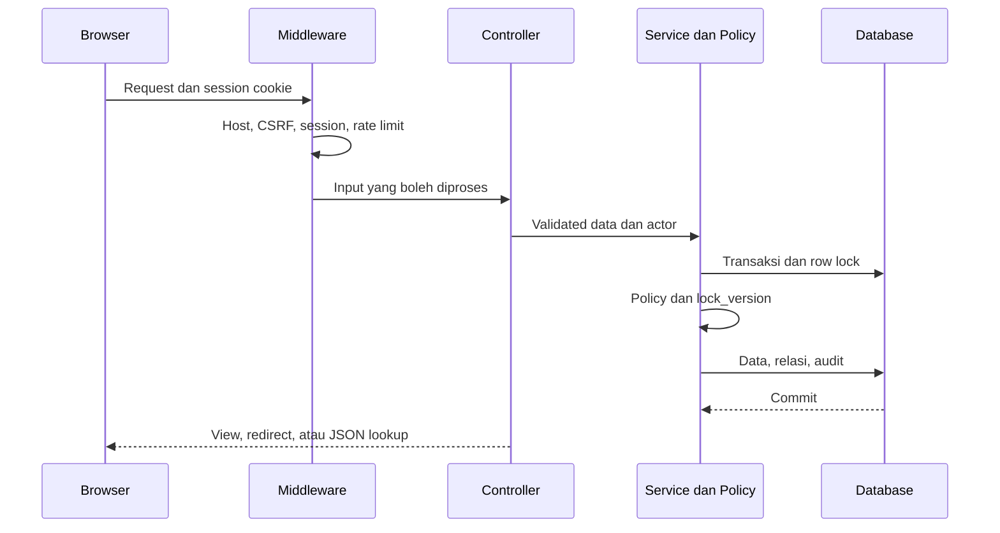
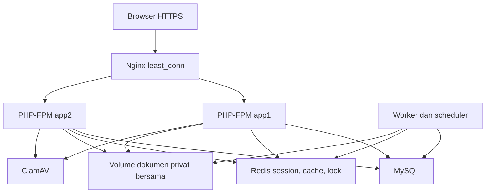

# Arsitektur dan struktur source

## Keputusan dasar

Aplikasi tetap satu Laravel monolith dengan Blade dan JavaScript kecil. Tidak ditambahkan microservices, SPA framework, AI agent, atau lapisan repository generik. Eloquent menangani query; service menangani transaksi/alur domain; policy menangani hak atas record. Pilihan ini menjaga biaya deployment dan kurva belajar sesuai kebutuhan repositori institusi.

## Peta folder

| Path | Tanggung jawab |
| --- | --- |
| `app/Http/Controllers/RepositoryController.php` | Halaman publik dan discovery |
| `app/Http/Controllers/Admin/` | Dashboard, karya, workflow, import, referensi, akun |
| `app/Http/Controllers/Auth/` | Login, reset, verifikasi email, konfirmasi password |
| `app/Http/Requests/` | Validasi input dan batas struktur array |
| `app/Http/Middleware/` | Session, akun aktif, role, security headers |
| `app/Models/` | Relasi Eloquent, casts, scope; `User` juga mengubah versi keamanan akun |
| `app/Policies/WorkPolicy.php` | Aturan akses publikasi/buku/HKI |
| `app/Services/` | Search, penyimpanan karya/dokumen, verifikasi/penerbitan, import, antivirus |
| `app/Support/` | Pemetaan jenis karya, katalog master, bounded lookup, aturan password dan versi |
| `app/Jobs/` | Job penerbitan yang idempotent |
| `app/Notifications/` | Verifikasi email dan reset password melalui queue setelah commit |
| `app/Console/Commands/` | Bootstrap admin, recovery queue, scan legacy, pemeriksaan production |
| `config/repository.php` | Pengaturan fitur dan keamanan khusus aplikasi |
| `database/migrations/` | Evolusi schema; jangan edit migration yang sudah dijalankan server |
| `database/factories/`, `database/seeders/` | Fixture pengujian dan data demo lokal |
| `resources/views/` | Layout, komponen, partial form, halaman per fitur |
| `resources/css/repository.css` | Design tokens, komponen, responsive, dark mode |
| `resources/js/` | Navigasi/repeater, tema, lookup, native dialog |
| `routes/` | Route web/auth dan scheduler |
| `tests/Feature/`, `tests/Unit/` | Perilaku aplikasi dan logika terisolasi |
| `deploy/` | Nginx, PHP-FPM, worker, load test |
| `docs/` | Panduan implementasi dan operasional saat ini |
| `public/build/` | Asset Vite hasil build yang siap disajikan |

Folder standar framework dipertahankan agar developer Laravel mudah berpindah dari dokumentasi resmi ke source. File `.env`, database lokal, vendor, node_modules, cache runtime, private documents, dan secrets tidak disertakan pada ZIP rilis.

## Urutan request

Controller referensi dan akun masih menampung transaksi pendek yang spesifik. Tidak dibuat service terpisah untuk setiap tabel hanya demi pola abstraksi. Pindahkan ke service bila perilaku yang sama mulai dipakai job/API/command lain.

## Model data inti

| Relasi | Implementasi / catatan |
| --- | --- |
| Fakultas → program studi → dosen | Hierarki institusi |
| Dosen ↔ penulis | Identitas penulis dosen; penulis mahasiswa/eksternal tidak wajib dosen |
| User ↔ penulis | Hubungan opsional, unik; akses kontributor bergantung pada hubungan ini |
| Publikasi ↔ penulis | Pivot urutan, penulis pertama, korespondensi, peneliti utama |
| Buku ↔ penulis | Pivot urutan dan korespondensi |
| HKI ↔ penulis | Pivot urutan pencipta |
| Publikasi → jurnal → penerbit | Metadata sumber publikasi |
| Buku → penerbit | Metadata penerbit buku |
| Publikasi ↔ pengindeks | Pivot tingkat pengindeksan dan tautan sumber |
| Publikasi → sitasi | Unik per tahun, sumber, cakupan |
| Karya → dokumen | Relasi polymorphic; hanya jenis karya yang diizinkan `WorkType` |
| Dokumen → document_versions | Versi immutable secara alur aplikasi, nomor versi unik |
| Publikasi → verification_histories / publish_attempts | Jejak verifikasi dan penerbitan |
| Record → audit_logs | Subject polymorphic, before/after; append-only melalui model |
| User → import_batches | Preview, kesalahan, status commit, pemilik batch |

ERD baseline tersedia pada paket induk. Tambahan rilis 1.3.0: `users.auth_version`, `users.lock_version`, `lock_version` pada sembilan tabel referensi, serta `scan_status`/`scanned_at` pada dokumen dan versi. Migration juga menambah indeks gabungan sesuai query aktual.

`lock_version` adalah token konflik edit; `auth_version` adalah token pencabutan sesi. Keduanya berbeda tujuan. Jangan menjadikan keduanya fillable dari request. Perubahan keamanan akun harus melalui instance Eloquent `User`, bukan bulk update yang melewati event model.

## Topologi deployment yang disertakan

`compose.production.yml` menjalankan dua proses aplikasi pada **satu Docker host**. Volume dokumen yang sama dipasang ke keduanya dan worker. Queue memakai database MySQL; Redis dipakai session, rate limiter, cache dan distributed lock. Root password MySQL hanya dipasang sebagai secret pada service MySQL.

Dua replica ini membagi beban proses aplikasi dan memudahkan restart terarah. Ini **belum high availability lintas host**: Nginx, mesin Docker, MySQL, Redis, dan volume tetap memiliki titik kegagalan tunggal. Untuk multi-host diperlukan shared filesystem atau integrasi private object storage, database/Redis yang dikelola sesuai target ketersediaan, dan load balancer eksternal. Jangan menjalankan dua server dengan disk private masing-masing.

## Perluasan jurnal 1.5

- `app/Support/JournalMetadata.php`: pilihan jenis karya, pemetaan peringkat referensi dan normalisasi input. WorkService memanggilnya di dalam transaksi sebelum menyimpan metadata/relasi.
- `app/Support/WorkFilters.php`: validasi dan lookup terbatasi yang digunakan controller daftar admin serta pencarian publik.
- `resources/views/partials/discovery-filters.blade.php`, `journal-metadata.blade.php`, `journal-tags.blade.php`: presentasi filter, detail dan badge yang digunakan ulang.
- `resources/js/source-choice.js`: progressive enhancement pilihan manual/referensi. Validasi dan normalisasi server tetap menjadi sumber kebenaran.
- `resources/css/journal-experience.css`: override visual terakhir setelah stylesheet awal dan experience.css. Token dark netral, toolbar dan editorial landing berada di sini.
- `public/images/library.webp`, `research.webp`: foto lokal terkompresi; tidak memerlukan request CDN saat halaman dibuka.

### Kredit foto

Foto perpustakaan: [Janko Ferlič / Unsplash](https://unsplash.com/photos/photo-of-library-with-turned-on-lights-sfL_QOnmy00). Foto proses riset: [UX Indonesia / Unsplash](https://unsplash.com/photos/person-in-blue-shirt-writing-on-white-paper-8mikJ83LmSQ). Digunakan sebagai ilustrasi menurut [Unsplash License](https://unsplash.com/license), bukan foto fasilitas atau kegiatan UMIBA. Pengelola dapat menggantinya dengan foto institusi yang berizin memakai nama berkas yang sama, lalu rebuild image Docker.

## Input bertahap dan referensi 1.6

| Komponen | Tanggung jawab |
| --- | --- |
| `WorkSubmissionService` | Transaksi metadata dan semua lampiran; kompensasi file jika proses gagal |
| `InlineReferenceService` | Resolusi penulis/dosen/jurnal/penerbit, afiliasi opsional, pemeriksaan konflik dan audit |
| `SpreadsheetTemplate` | Membuat template XLSX dengan kolom berformat teks dan header beku |
| `SpreadsheetReader` / `ImportService` | Parse terbatas, preview tanpa mutasi referensi, validasi ulang dan commit batch |
| `DocumentTypes` | Label jenis dokumen yang konsisten |
| `resources/js/work-wizard.js` | Navigasi tiga tahap, fokus dan validasi browser |
| `resources/js/source-choice.js` | Pergantian rekomendasi/manual dan label dokumen, termasuk repeater |
| `resources/css/guided-submission.css` | Spacing form bertahap, spinner, logo dan panduan landing |

`publikasi.isbn` merupakan ISBN terbitan prosiding dan tidak unik; beberapa artikel boleh merujuk ISBN yang sama. `issn_cetak` dan `issn_elektronik` menyimpan identitas terbitan pada karya. `dosen.program_studi_id` nullable; direktori menampilkan “Program studi belum dicatat” bila kosong. Semua identitas penulis tetap terpisah dari akun login.

Logo `public/images/umiba-logo.jpg` diambil tanpa digambar ulang dari [situs resmi Universitas Mitra Bangsa](https://umiba.ac.id/) pada 13 November 2026. File wordmark resmi: https://umiba.ac.id/wp-content/uploads/elementor/thumbs/Logo_UMIBA_lg_new-qhkclhufshfolaikz09eogro87mlve4o2oo03x5enq.jpg. Digunakan sebagai identitas institusi; deployment resmi tetap dikelola pihak berwenang. Gambar disajikan lokal, bukan hotlink.
